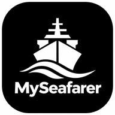

# MySeafarer

A free app for seafarers to track certificates, sea time and the current contract. **Works offline** once installed.

**Open the app:** https://muhammdfhmii.github.io/MySeafarer-app/

## Install on your phone

**iPhone (Safari):** open the link → tap the Share button → **Add to Home Screen**.
**Android (Chrome):** open the link → tap ⋮ → **Install app** (or **Add to Home screen**).

Open it once with internet. After that it works at sea without signal.

## Your data

- Everything you enter is saved **on your own phone only**. Nothing is uploaded, and nobody else can see it.
- Use **Backup** in the app to save a backup file now and then, especially before changing phones or clearing your browser.
- To move to a new phone: Backup on the old phone → send the file to yourself → **Backup → Restore** on the new phone.

## What it does

- Certificates with expiry dates, grouped by STCW category, with renewal alerts 6 months before expiry
- STCW checklist (standard courses plus your own)
- Sea time: time with operator, time in rank, time on watch, tanker time (1 month = 30.44 days)
- Current contract: length, expected sign-off, wages and estimated earnings
